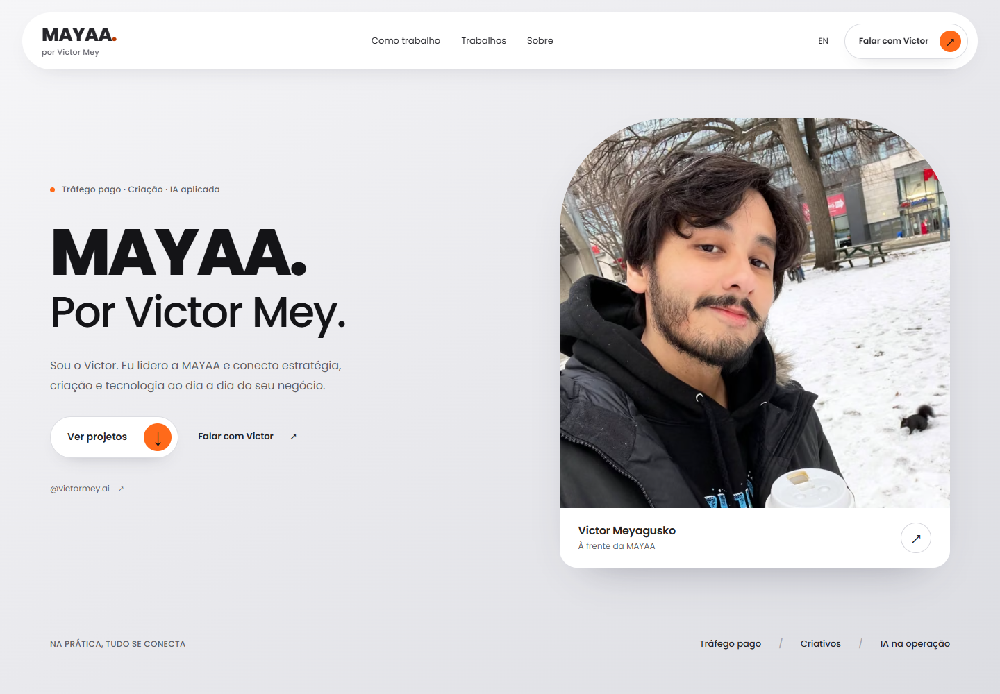
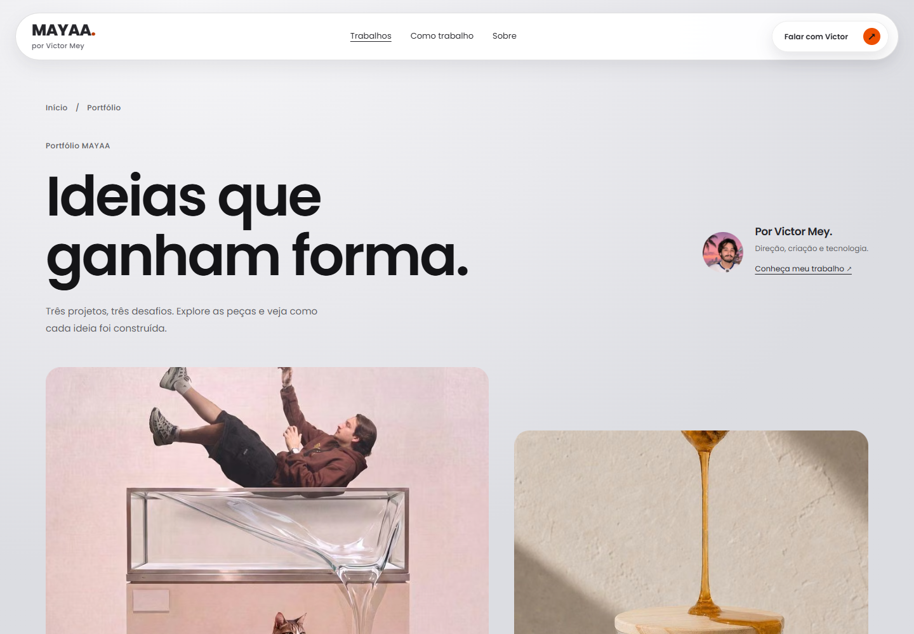

# Entrega local — MAYAA por Victor Mey · 13/11/2026

## Resultado e autorização
Victor pediu a skill própria de referências de sites e aprovou a combinação apresentada com «Pode seguir». Implementada a assinatura MAYAA por Victor Mey, com retrato real de Victor na abertura, projetos antes dos serviços e identidade dos últimos posts claros do feed. A aprovação refere-se à direção e à implementação local; nenhum commit, push, deploy, campanha ou envio a terceiro nesta etapa.

Prévia: http://127.0.0.1:8843/ · http://127.0.0.1:8843/portfolio/
Repositório: C:/Users/vicde/repos/mayaastudio-site · branch codex/victormey-identity-20261113.

## Amostra e referências
| Amostra local | Referência | Princípio aplicado |
|---|---|---|
|  | [Dennis Snellenberg](https://www.dennissnellenberg.com/) | Pessoa real protagonista, nome visível e contato direto. |
|  | [Worth Agency](https://worth.agency/) | Galeria com larguras distintas, imagens grandes e legendas de contribuição. |
| [Projetos no celular](portfolio-390.png) | [Norm Architects](https://normcph.com/) | Fotografia com contexto curto, espaço entre projetos e leitura simples. |

Norm é a referência fora do setor. Worth veio do Refero público; Dennis e Norm de pesquisa complementar. A folha completa, os limites de acesso e o que não copiar estão no vault. Awesome Design MD/Apple entrou apenas como apoio ao princípio de fotografia protagonista. Não foram copiados textos ou ativos dos sites externos.

## Implementação
- Home canônica: build/victor-home.html; cópia idêntica em site/index.html. Estilos theme.css + agency.css; interação home.js.
- Portfólio: site/portfolio/index.html + assets/victor/portfolio.css. Cabeçalho, rodapé e autoria consistentes nas sete páginas; casos existentes preservados.
- Retrato real em AVIF com fallback WebP; avatar WebP reduzido de 222 KB para 15 KB; capas de portfólio em AVIF com fallback JPEG. Sem geração, retoque ou gasto com mídia.
- Menu disponível sem JavaScript e alternativa móvel interativa com Escape/foco. Detecção de JavaScript no head evita deslocamento do layout; folha de tokens carrega diretamente, sem encadear @import.
- Contato geral abre @victormey.ai; diagnóstico e-commerce permanece alternativa específica. SEO, dados estruturados e imagem de compartilhamento atualizados.

## Verificação
Playwright em Chrome real: 7 rotas × 2 larguras (1440 e 390). Sem erro de JavaScript, imagem quebrada, âncora inválida ou transbordamento horizontal. Verificados menu/Escape/foco, PT/EN, links de projeto, FAQ, autoria, caminho geral de contato e diagnóstico específico, modo sem JavaScript e redução de movimento. Evidência detalhada em checks.json e check.mjs; screenshots de cada rota nesta pasta. git diff --check sem erros.

Lighthouse mobile em servidor local, rede/CPU simuladas; não são métricas reais de produção:

| Página | Desempenho / Acessibilidade / Boas práticas / SEO | LCP | CLS |
|---|---|---|---|
| Home | 99 / 100 / 100 / 100 | 2.2 s | 0 |
| Portfólio | 99 / 100 / 100 / 100 | 2.1 s | 0.001 |

## Portão de design
| Item | Evidência e decisão |
|---|---|
| Brandbook | Poppins local, cinza/branco/laranja do feed; MAYAA por Victor e retrato real. |
| Anti-genérico | Portfólio assimétrico; serviços em linhas; autoria identificável; sem cards repetidos de benefícios. |
| Referências | Dennis, Worth e Norm aprovados; Apple como princípio auxiliar de awesome-design-md. |
| Movimento | Hover/reveal com transform/opacity, duração curta; sem vídeo automático, scroll capturado, WebGL ou loader. Reduced motion testado; 60 fps não medido instrumentalmente. |
| Mobile 390 | Capturas de sete páginas, sem corte/overflow; ações principais e controles de menu com alvo mínimo de 44 px. |
| Acessibilidade | Lighthouse 100 nas duas entradas, alt/foco e teclado verificados; auditoria automática não substitui avaliação completa com leitor de tela. |
| Desempenho | LCP <2,5 s em ambas as entradas; CLS zero na home e 0,001 no portfólio. |
| Prova | home-1440-top.png, home-390-top.png, portfolio-1440.png, portfolio-390.png e demais capturas; checks.json e relatórios Lighthouse. |
| Impeccable | Revisão manual Xquads 8,6/10. Detector não atribui nota: 2 heading-rhythm revisados como falsos positivos de grid, 3 advisory de borda+sombra coerentes com o componente. |
| Animação | Uso apenas de transform/opacity; redução de movimento validada. Não houve nova animação de vídeo ou GSAP. |
| Vídeo / 3D | Não produzidos nesta etapa; materiais dos cases preservados. |
| Fotos de detalhe | Não houve geração de hero/crops; retrato real e capas existentes apenas comprimidos para web. |
| Especialista | Revisão independente Xquads UX Designer + Brad Frost, agente xquads_revisao_final, nota 8,6/10, sem bloqueador visual. |

## Pendências reais
O diagnóstico público ainda exige publicação do backend corrigido, migrações e OAuth da agenda de victor.meyagusko1@gmail.com. Os horários aprovados 12h, 19h e 20h permanecem na implementação do funil. A aprovação visual não comprova reunião real: não houve gravação no Google Calendar nem teste de entrega de convite. Antes de mandar tráfego, concluir o go-live conforme a nota de funil no vault. Deploy requer aprovação explícita do Victor conforme AGENTS.md.

O servidor de prévia é local e depende do computador ligado. Reinício: python -m http.server 8843 --bind 127.0.0.1 --directory C:/Users/vicde/repos/mayaastudio-site/site

## Publicação autorizada — 13/11/2026

Victor: «Publique o site para eu conferir». Publicação autorizada no domínio existente via GitHub Pages. Na checagem pré-deploy, diagnóstico/ecommerce ainda retornava 404; os três CTAs públicos dessa rota foram encaminhados ao Instagram e os textos deixaram de prometer agenda automática. A aplicação do funil continua preservada e será reconectada após OAuth e deploy próprios. QA de navegação executado novamente; os relatórios Lighthouse acima medem a versão visual, anterior a esta troca de destino/texto.
